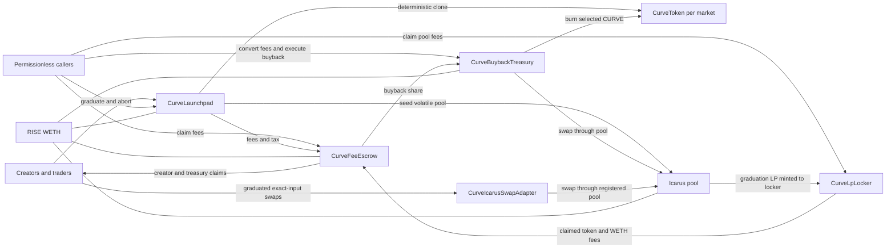
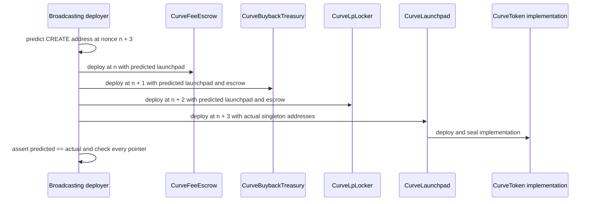
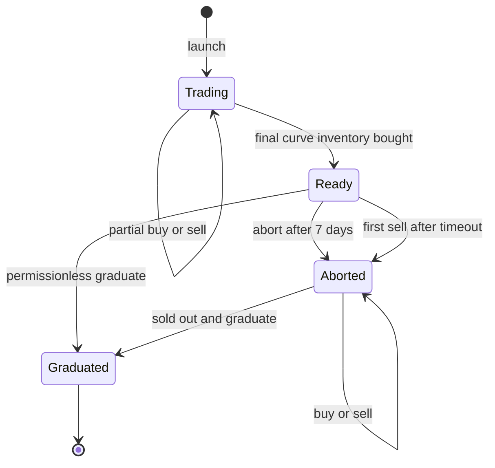

# Architecture

## System purpose

Curveball launches fixed-supply ERC-20 tokens on isolated virtual-reserve bonding curves. Each market sells at most 80% of its supply, uses part of the remaining inventory to seed and permanently lock liquidity in an external Icarus volatile pool, and burns the rest. Curve fees are split among the creator, protocol treasury, and a shared treasury that buys and burns CURVE. The short-lived opening buy tax goes directly to the protocol treasury.

The protocol has no upgradeable proxy or upgrade mechanism. It consists of four directly deployed singleton modules, one immutable token implementation cloned per market, a separately deployed swap adapter, a pure math library, and two external integration seams.

## Modules and state ownership

| Module           | Interface and responsibility                                                                      | State owned by the implementation                                                                                                                                                  |
| ---------------- | ------------------------------------------------------------------------------------------------- | ---------------------------------------------------------------------------------------------------------------------------------------------------------------------------------- |
| `CurveLaunchpad` | Launch, buy, sell, abort, graduate, previews, bounded administration                              | Every `Market`, per-creator launch nonce, historical `held` ledger, defaults, target, pause state, and aggregate curve liabilities                                                 |
| `CurveToken`     | Fixed-supply market ERC-20 with a pre-graduation transfer lock                                    | Clone balances, allowances, total supply, permit nonces, metadata, initialization flag, and permanent unlock flag; launchpad authorization is immutable in implementation bytecode |
| `CurveFeeEscrow` | Backed fee accounting, pull claims, fee transfer, surplus rescue | Claimable balances and per-asset aggregate liabilities                                                                                       |
| `CurveBuybackTreasury` | Shared fee custody, guarded market-token conversion, CURVE buybacks | Global WETH budget, token fee credits, selected CURVE, observation boundaries |
| `CurveLpLocker`  | Permanent LP custody and permissionless fee forwarding                                            | Registered pool-to-market mapping; it has no LP withdrawal interface                                                                                                               |
| `CurveIcarusSwapAdapter` | Direct exact-input swaps on graduated market pools | No mutable state; it validates the registered canonical pool and transfers input directly into that pool |
| `CurveMath`      | Curve quotations, target initialization, pool-seed calculation, and fee splitting                 | No state                                                                                                                                                                           |
| Icarus seam      | Factory discovery/creation, pool reserves, liquidity minting, swaps, observations, and fee claims | External factory and pool state                                                                                                                                                    |
| Quote-token seam | Curve reserve, fee asset, pool quote asset, and buyback input                                     | External ERC-20 state; configured as RISE WETH                                                                                                                                     |

`CurveLaunchpad` is the coordinating deep module: callers use a compact lifecycle interface while token deployment, fee routing, custody, state transitions, and pool graduation stay local to its implementation.

Cross-module interfaces are intentionally narrow:

- `ICurveLaunchpad` exposes only the treasury, locker, snapshotted fee policy, and graduated pool needed by the other contracts.
- `ICurveSingletons` exposes only fee distribution, graduation observation recording, and pool registration.
- `IIcarusFactory` and `IIcarusPool` describe only the external behavior Curveball invokes.

## Immutable topology and deployment order

The escrow and locker require the launchpad address in their constructors, but the launchpad must receive their deployed addresses. `CurveDeploy` resolves this cycle by predicting the launchpad address from the deployer's nonce.

Any nonce shift causes the deployment to revert with `AddressPredictionMismatch`; every immutable cross-reference and authority is checked after construction. The launchpad constructor's internal creation of the token implementation occurs after the launchpad address is fixed and does not consume the external deployer's nonce.

## Market lifecycle

State meanings:

- `None`: no market exists for the token address.
- `Trading`: buys and sells are open.
- `Ready`: all 800,000,000 curve tokens are sold; trading is closed and graduation is immediately available.
- `Aborted`: a `Ready` market remained ungraduated for seven days. Sells reopen permanently, buys work whenever inventory is available, and graduation remains possible whenever the curve sells out again.
- `Graduated`: curve accounting is closed, token transfers are unlocked, liquidity is seeded, LP is locked.

`Aborted` is deliberately sticky. Re-selling out emits `GraduationReady` but does not return the market to `Ready`, so holders never lose their reopened sell path.

The launchpad pause is orthogonal to market state. It stops only new launches and buys. Sells, aborts, graduation, LP fee collection, fee claims, and buybacks remain available.

## Asset and accounting domains

Curveball keeps three distinct accounting domains:

1. **Curve inventory and quote liability** — the launchpad holds unsold market tokens and WETH backing each market's `realQuote`. `totalRealQuote` aggregates all ungraduated market liabilities.
2. **Fee liabilities** — the escrow backs creator and protocol claims. The buyback treasury separately backs its WETH budget and each graduated market-token fee credit.
3. **LP principal** — the locker receives the LP minted by Curveball's graduation except Icarus's protocol-level minimum-liquidity lock. No Curveball function can move that LP; this does not prevent unrelated parties from adding later pool liquidity.

These domains do not share rescue capacity. Launchpad rescue is limited by `totalRealQuote`; escrow rescue is limited by `totalOwed`; locker LP has no administrative rescue path.

## End-to-end flows

### Launch

1. The creator supplies metadata, creator tax, and an optional first-buy budget.
2. The launchpad validates URI length and tax against the current cap, then deploys a deterministic EIP-1167 clone using `keccak256(abi.encode(creator, launchNonce))`. At this point it snapshots the creator, fee policy, tax, launch time, and initial virtual reserves.
3. The launch fee transfers directly to the treasury.
4. The token initializes once and mints the full supply to the launchpad.
5. `LaunchCreated` emits the launch metadata and policy snapshot.
6. An optional first buy follows the same path as every later buy and delivers tokens only to the payer.

The URI is emitted in `LaunchCreated` but is not stored on-chain.

### Curve buy

1. `CurveMath` removes curve fee, creator tax, and any opening anti-snipe tax from the caller's maximum total spend. It computes output from the virtual constant product, capped at the wallet's remaining curve capacity.
2. The launchpad decreases virtual-token reserves, increases virtual and real quote, increases `totalRealQuote`, and credits the caller's `held` ledger.
3. Curve quote transfers from the buyer to the launchpad.
4. Curve fee and creator tax transfer directly from the buyer to the escrow before `distribute` records liabilities. Any opening anti-snipe tax transfers directly to the protocol treasury.
5. Market tokens transfer from the launchpad only to the buyer.

The opening tax is 9,900, 2,500, 300, 36, and 4 bps in seconds 0 through 4 after launch, respectively, and zero thereafter. The immutable per-wallet cap applies to each address's net curve buys; selling reopens capacity. There is no recipient parameter. Together with the token lock, this prevents a buyer from routing curve tokens into the future pool before graduation. Approvals and permits may exist before graduation, but they cannot move tokens between other addresses or enable holder burns.

### Curve sell

1. A timed-out `Ready` market first becomes `Aborted` inline.
2. `CurveMath` computes gross curve quote, fee, tax, and net output.
3. The seller's `held` balance, market `realQuote`, and global `totalRealQuote` decrease by the gross amount.
4. Tokens return to the launchpad, net WETH goes to the seller, and retained fee/tax goes to the escrow.

### Graduation

1. The launchpad accepts `Ready`, or `Aborted` only when exactly sold out.
2. It marks the market `Graduated`, clears its curve liability, and permanently unlocks the token.
3. It obtains or creates the canonical volatile Icarus pool. An existing pool must have zero LP supply.
4. It skims unsynced balances back to the launchpad and rejects any synced market-token reserve.
5. Curve WETH plus any synced WETH reserve is paired with tokens at the closing curve price, subject to the available non-curve inventory and token balance.
6. LP is minted directly to the locker, then exact post-mint token and quote reserves are verified.
7. Every market token left at the launchpad is burned and the pool is registered with the locker.

Quote-side donation size cannot make graduation revert: synced WETH is matched while burn-buffer inventory exists, then the token input clamps and the donor receives a worse opening price. This guarantee does not apply to a pool already containing LP or synced market tokens; both are intentionally rejected as `PoolUsed`.

### LP fees and escrow

Anyone can trigger `CurveLpLocker.claim` for a registered pool. The locker attributes only the amounts returned by Icarus `claimFees`, transfers those assets to the escrow, and then calls `distribute`. Stray balances are not assigned to a market.

Buyback fee shares move to the dedicated treasury immediately. WETH joins the global CURVE buyback budget; market-token shares remain credited there until a guarded pool conversion adds WETH to that budget. Creator and protocol shares remain pull-based claims in the escrow.

The locker does not independently validate the pool's two asset addresses. Safety relies on registration being launchpad-only and following canonical factory lookup/creation and verified seeding.

### CURVE buyback

CURVE is an ordinary factory token. After it graduates, the owner timelock sets its address once in the buyback treasury. Permissionless execution converts market-token LP fee shares into WETH. The owner can trigger a CURVE buyback at any time; other callers can trigger one after a full day without a successful buyback. Both swap paths use post-graduation TWAP history and bounded impact. Each market still burns unseeded inventory at graduation.

### Graduated trading

The separately deployed `CurveIcarusSwapAdapter` provides exact-input swaps for a graduated market. It requires the launchpad's recorded pool to match the factory's canonical volatile pool and verifies the token pair and factory pause state. The caller supplies WETH for a buy or market tokens for a sell; the adapter transfers input directly into that pool and sends output directly to the caller. `quoteExactIn` uses the pool's fee-inclusive spot quote, while `swapExactIn` checks a deadline and minimum output at execution. The adapter neither routes through other pools nor holds trading inventory.

## Roles and authority

| Role          | Powers                                                                                                                                                         | Explicit limitations                                                                                                                                                        |
| ------------- | -------------------------------------------------------------------------------------------------------------------------------------------------------------- | --------------------------------------------------------------------------------------------------------------------------------------------------------------------------- |
| Owner         | Launchpad owner updates future defaults and target, rotates guardian, unpauses, and rescues surplus; escrow owner rescues escrow surplus; buyback treasury owner selects CURVE once and may trigger immediate buybacks | Two-step ownership; cannot renounce; target must meet minimum, exact-divisibility, and `uint128` bounds; cannot change snapshotted markets, immutable addresses, LP custody |
| Guardian      | Pause launches and buys                                                                                                                                        | Cannot unpause, seize assets, modify policy, block sells, or block graduation                                                                                               |
| Treasury      | Receives launch fee and protocol fee share                                                                                                                     | Immutable recipient, no special callable authority                                                                                                                          |
| Creator       | Chooses metadata, tax within current cap, and optional first buy                                                                       | Fee policy and tax are fixed for that market after launch                                                                                                                   |
| Trader        | Buy and sell subject to state, pause, deadline, balance, and slippage                                                                                          | Pre-graduation transfers cannot bypass the curve                                                                                                                            |
| Public caller | Graduate, abort after timeout, claim LP fees, execute buybacks, and claim own balances                                                                         | Cannot redirect another account's claim or move locked LP                                                                                                                   |
| Icarus pauser | Pauses Icarus swaps                                                                                                                                            | Under the integrated Icarus implementation, pause affects swaps only and does not block graduation; paused swaps make buyback skip                                          |

Mainnet deployment creates a self-administered OpenZeppelin timelock with a two-day delay and gives launchpad, escrow, and buyback treasury that owner. The `curveball` deployer EOA holds the proposer, canceller, and executor roles and serves as guardian. The separately pinned treasury EOA receives protocol fees. The three ownership roles can later be transferred independently through timelocked actions. The deployment recorder checks the timelock runtime bytecode, delay, and roles against the compiled release.

All value-moving launchpad entry points and escrow functions that transfer fee assets use `nonReentrant`. `markGraduated` only records a seeded observation boundary through the treasury. The ownerless locker relies on narrow registration authority, fixed trusted adapters, and state/backing checks before onward transfers.

## Upgradeability and immutability

- No Curveball singleton or swap adapter is proxied or upgradeable. Market tokens are immutable EIP-1167 clones.
- Singleton addresses and the quote token/factory references are immutable.
- Market tokens are deterministic clones of the immutable implementation created by the launchpad constructor.
- Each market snapshots economic policy at launch; later owner changes apply only to new markets.
- The treasury and launch fee are immutable launchpad values.
- The locker has no owner.
- Ownership renunciation is disabled on all three owned modules.

## Source map

| Topic                            | Primary source                      |
| -------------------------------- | ----------------------------------- |
| Market lifecycle and accounting  | `contracts/CurveLaunchpad.sol`      |
| Curve formulas and fee splitting | `contracts/libraries/CurveMath.sol` |
| Token clone and transfer lock    | `contracts/CurveToken.sol`          |
| Fee claims and distribution      | `contracts/CurveFeeEscrow.sol`      |
| Fee conversion and CURVE buybacks | `contracts/CurveBuybackTreasury.sol` |
| LP custody and pool fee routing  | `contracts/CurveLpLocker.sol`       |
| Graduated exact-input swaps | `contracts/CurveIcarusSwapAdapter.sol` |
| External integration surface     | `contracts/interfaces/IIcarus.sol`  |
| Immutable deployment wiring      | `scripts/CurveDeploy.sol`           |
| Network policy and preflight     | `scripts/Deploy.s.sol`              |
