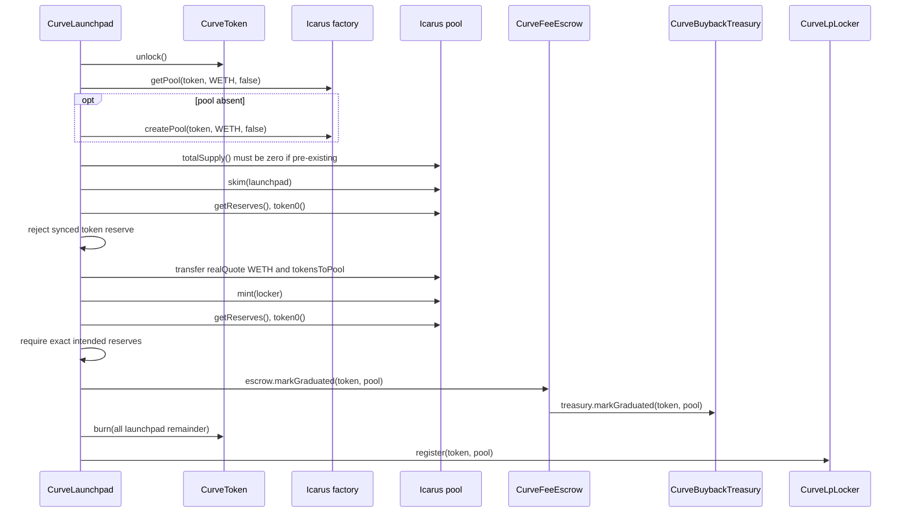
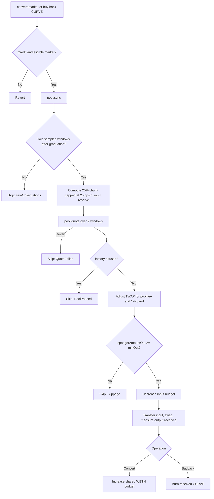

# Integration and deployment specification

Curveball has two production integration seams: the configured quote token (RISE WETH) and the configured Icarus factory/pools. Their implementations are external to this repository. This document separates behavior enforced by Curveball from behavior assumed of those dependencies.

## Supported networks and addresses

| Network      | Chain ID | WETH                                         | Icarus factory                               | Fork block |
| ------------ | -------: | -------------------------------------------- | -------------------------------------------- | ---------: |
| RISE mainnet |     4153 | `0x4200000000000000000000000000000000000006` | `0xEe10C6a0f158bFEeef3d48Dc0D26130Cf6115615` | 24,722,082 |
| RISE testnet | 11155931 | `0x4200000000000000000000000000000000000006` | `0x8221dfB70c9A2dE60253dcfC58231FD529bbF4F9` | 57,239,173 |

The fork blocks are test fixtures, not deployment blocks. `deployments/11155931/curveball.json` records an older testnet release with the removed `CurveHolderReserve`, a 0.001 WETH launch fee, and a 0.01 WETH target. It does not attest the current four-singleton source or its 5% wallet cap. There is no mainnet Curveball deployment record in this checkout.

The Icarus [contract architecture page](https://docs.icarus.finance/protocol/contract-architecture-and-developers) lists **mainnet** addresses. Curveball uses the basic `PoolFactory` and its volatile pools, not `PoolFactoryV3`, `PoolImplementation` from the concentrated-liquidity list, or either router. On testnet, the basic factory's `implementation()` is `0x74309f2134DA3E920094A5B0d5DF5d5Dcd1942b1`. The factory clones that implementation for each pool; a historical smoke-test pool is recorded in `deployments/11155931/smoke.json`.

### Secondary trading decision

Curveball follows a launchpad-to-AMM migration flow. `graduate()` creates or reuses the volatile pool, seeds its opening WETH/token reserves at the curve's closing price, and mints LP directly to `CurveLpLocker` in one transaction. There is no separate pool-creation or liquidity-provisioning transaction for an operator to run.

For the current one-hop WETH/token market, `CurveIcarusSwapAdapter` executes exact-input trades against the recorded pool. It accepts only a graduated pool also returned by the configured factory, checks pool token ordering and the factory pause, and enforces `minOut` and `deadline`. The frontend wraps ETH to WETH for buys, approves the adapter, and quotes the same pool's fee-inclusive `getAmountOut`. This quote is an execution estimate, not a guarantee; the swap checks `minOut` again at execution. The adapter does not search routes or accept an arbitrary destination pool.

The mainnet classic `Router` is `0x4015CF08a5b5d325C2F7989Af2Ac591625668A4C`; its live `defaultFactory()` is the basic factory listed above and it offers `getAmountsOut` for classic routes. It is an optional later execution path for multi-hop trading or native-ETH entry, not a graduation dependency. The address listed as `Quoter` (`0x69F70658A8BDEC7cac725541518b9413498acB72`) is verified as `QuoterV2` and exposes V3-style `quoteExactInput` functions. It is not the quote interface for this basic pool. `MixedQuoter` is relevant only if Curveball later supports routes across basic and concentrated pools. Any route expansion needs its own route selection, allowance target, slippage checks, and fork verification before replacing the direct-pool path.

The swap adapter is deployed separately from the launchpad. The testnet adapter is recorded in `deployments/11155931/icarus-swap-adapter.json`; a mainnet adapter record is required before the app can enable mainnet pool trading. No gauge, voter, escrowed IRS, concentrated pool, position manager, or fee module is needed for the current product flow.

## Icarus factory interface

Curveball calls:

| Function                            | Curveball use                      | Required semantics                                                      |
| ----------------------------------- | ---------------------------------- | ----------------------------------------------------------------------- |
| `isPaused()`                        | Treasury conversion and buyback    | Returns global swap-pause state                                         |
| `getPool(tokenA, tokenB, false)`    | Graduation                         | Symmetric lookup of the canonical volatile token pair                   |
| `createPool(tokenA, tokenB, false)` | Graduation                         | Creates and returns that canonical volatile pair                        |
| `getFee(pool, false)`               | Treasury conversion and buyback    | Returns current volatile swap fee in basis points                       |
| `getUnstakedFee(pool)`              | Not called by production Curveball | Present in the narrow interface for integration compatibility and mocks |

Curveball always requests `stable = false`.

Graduation, LP fee collection, and treasury swaps trust the factory to return the correct token/WETH pair; they do not independently require the returned pool's two tokens to equal the requested pair. Reserve mapping, LP fee attribution, conversion, and buyback orientation rely on canonical factory behavior. The separately deployed swap adapter checks both pool tokens before each trade.

The fee is assumed to be at most 10,000 bps. The treasury does not independently bound the value returned by `getFee`; a larger value makes checked conversion or buyback arithmetic revert.

## Icarus pool interface

| Function                                 | Required semantics                                                                            |
| ---------------------------------------- | --------------------------------------------------------------------------------------------- |
| `token0()`, `token1()`                   | Consistent token ordering; reserves and fee-return tuples follow this orientation             |
| `totalSupply()`                          | Nonzero means the pool has already been initialized and must not be used for graduation       |
| `balanceOf(account)`                     | Standard LP balance view                                                                      |
| `getReserves()`                          | Returns reserves corresponding exactly to `token0` and `token1`                               |
| `mint(to)`                               | Consumes deposited balances, updates reserves, and mints LP to `to`                           |
| `skim(to)`                               | Transfers balances above recorded reserves to `to` without changing reserves                  |
| `sync()`                                 | Folds live balances into reserves and updates cumulative/observation state                    |
| `swap(amount0Out, amount1Out, to, data)` | Pays the requested output after input was transferred; obeys factory swap pause               |
| `claimFees()`                            | Transfers the caller's LP fee entitlement and returns exact token0/token1 amounts transferred |
| `getAmountOut(amountIn, tokenIn)`        | Current-reserve, post-pool-fee output                                                         |
| `quote(tokenIn, amountIn, granularity)`  | Fee-free TWAP output over the requested observation windows                                   |
| `observationLength()`                    | Number of available TWAP observations                                                         |

Additional assumptions exercised by the mock and fork suites:

- Tokens are sorted consistently into token0/token1.
- The volatile pool has a 1,000-LP-base-unit minimum-liquidity lock on first mint.
- Only swaps are assumed to be blocked by the factory pause; `mint`, `skim`, `sync`, observation reads, and fee claims remain usable. Live forks exercise paused graduation, LP fee claims, and buyback skipping.
- An observation is appended on a pool update after more than 1,800 seconds since the last one. A quiet pool can have much longer intervals; `quote(..., 2)` averages the last two interval prices equally, so it does not guarantee a one-hour lookback. A bot can call `sync()` about every 30 minutes when that cadence is required.
- `quote` may underflow or revert when insufficient observation history exists.
- The testnet factory currently directs 10% of each swap fee to `gaugeFees` and 90% to unstaked LPs. The gauge share accumulates even before IRS emissions begin. Staking in a gauge changes the incentive path; Curveball's locked LP is not staked and `claimFees` pays its LP share only. Both the pool swap fee and the unstaked/gauge allocation are configurable, including per-pool overrides; read `getFee(pool, false)` and `getUnstakedFee(pool)` at use time.
- Pool fee and unstaked fee values use basis points.

The mock creates pools deterministically with CREATE2, but production Curveball neither predicts nor depends on the pool address. It relies solely on `getPool` and `createPool`.

## Pool orientation

All production paths support either ordering:

- Graduation maps `getReserves()` according to whether `token0 == marketToken`.
- Treasury conversion and buyback derive the relevant input reserve and select `amount0Out` or `amount1Out` from the same comparison.
- LP fee collection maps the two amounts returned by `claimFees` and treats the pool's other token as quote.

Orientation correctness still depends on the factory returning a pool containing exactly the market token and WETH.

## Graduation integration protocol

Graduation calls external modules in this order:



The market is marked graduated and its quote liability is cleared before external calls, but EVM atomicity rolls all of that back if any integration call fails.

### Pool contamination and donations

| Pool condition before graduation                   | Result                                                                                                                                                            |
| -------------------------------------------------- | ----------------------------------------------------------------------------------------------------------------------------------------------------------------- |
| No pool exists                                     | Create volatile pool and seed it                                                                                                                                  |
| Pool exists, no LP, no balances                    | Reuse and seed it                                                                                                                                                 |
| Unsynced WETH donation                             | `skim` returns it to launchpad; it becomes launchpad surplus                                                                                                      |
| Unsynced market-token balance                      | `skim` returns it to launchpad and excess is burned; ordinary holders cannot create this before graduation because the token lock blocks holder-to-pool transfers |
| Synced WETH reserve                                | Included in `quoteInPool` and matched at closing curve price while token buffer permits                                                                           |
| Synced WETH exceeds matchable buffer               | Token input clamps; the pool opens at a higher quote-per-token price and donated excess is not recovered through graduation                                       |
| Synced market-token reserve                        | Revert `PoolUsed`                                                                                                                                                 |
| Nonzero LP supply                                  | Revert `PoolUsed`                                                                                                                                                 |
| Post-mint reserves differ from exact intended seed | Revert `MintMismatch`                                                                                                                                             |

The donation-resistance design is specifically quote-side: within WETH supply/arithmetic bounds and expected Icarus mint semantics, WETH donation alone should not wedge graduation. Token-side synced contamination and previously initialized pools are intentionally rejected.

The return value of `pool.mint` is ignored. Exact post-mint reserves are checked, while the production graduation function does not independently assert a nonzero LP return or query the locker LP balance. The fork suite verifies expected Icarus mint behavior.

## LP fee integration protocol

The pool mints Curveball's LP position directly to `CurveLpLocker`. The locker has no owner, transfer, withdrawal, or rescue function.

Anyone may invoke `claim(pool)`:

1. Require pool registration.
2. Call Icarus `claimFees()`.
3. Interpret returned token0/token1 amounts by orientation.
4. Transfer each nonzero returned amount to escrow.
5. Call `distribute` only after the transferred asset backs the new liability.

Under the required honest `claimFees` semantics, using returned amounts rather than locker balance differences prevents unrelated token transfers from being attributed to a market. Exact return/transfer correspondence is a trusted pool assumption: an under-transfer normally makes the subsequent safe transfer revert, but existing stray locker balance could cover a shortfall from a dishonest return and be misattributed.

## Treasury conversion and buyback integration protocol

`CurveFeeEscrow.distribute` transfers each market's buyback fee share to `CurveBuybackTreasury` and calls `fund` after the transfer. WETH credits increase the shared `quoteBudget`; graduated market-token credits increase `tokenBudget[market]`. The treasury records each pool's observation count during graduation, so swaps cannot use observations from an empty pre-created pool. The owner may select a single graduated market with `setCurveToken` once. Only that token can be bought and burned.

`convert(market)` sells a bounded chunk of that market's token-fee credit to WETH and adds the actual WETH received to the shared quote budget. `buyback()` spends a bounded chunk of that budget on the selected CURVE token and burns the actual tokens received. The owner can call `buyback()` whenever it has budget; after a successful burn, other callers must wait one day. Conversion has no one-day gate. Both functions are permissionless subject to those conditions.



Pause is checked before input transfer so the expected paused condition returns a clean skip without touching balances or relying on swap rollback. Successful accounting updates precede the transfer/swap, but unexpected downstream failure reverts them atomically.

Only the TWAP `quote` call is caught. A revert from `sync`, orientation or reserve reads, factory fee reads, `getAmountOut`, token transfer, or `swap` reverts the transaction. The four environmental skip paths preserve the relevant budget and do not update `lastBuyback`; a successful `buyback()` updates it before the swap, subject to transaction rollback.

## WETH and ERC-20 requirements

Production treats WETH only as an ERC-20; it never unwraps native ETH. Fork tests call `deposit()` solely to fund test actors.

Required quote-token behavior:

- 18 decimals, matching parameters expressed in `ether` units.
- Standard `balanceOf`, `transfer`, and `transferFrom` behavior compatible with `SafeERC20`.
- No transfer fee, rebasing, or hooks that change received amounts.
- No unexpected callback/reentrancy behavior.

Exact curve liabilities and exact pool reserve checks make fee-on-transfer or rebasing quote tokens unsupported. The Solidity `Deploy` preflight checks that WETH has code but does not verify name, symbol, decimals, bytecode hash, or implementation. The separate mainnet `verify-icarus` Make gate compares pinned WETH code hash and its evidence-generation path checks metadata.

Launched tokens use Solady ERC-20 behavior with 18 decimals, clone-specific permit domains, disabled automatic Permit2 infinite allowance, and the Curveball transfer lock described in the protocol specification. Icarus pool creation is assumed compatible with both assets' ERC-20 metadata calls, including `symbol()` and `decimals()`; CurveToken satisfies these calls, while deployment does not independently validate WETH metadata.

## Deployment parameters

Shared parameters encoded by `Deploy`:

| Parameter         | Value           |
| ----------------- | --------------- |
| Quote token       | RISE WETH above |
| Launch fee        | 0.00045 WETH    |
| Wallet cap        | 500 bps of 800 million curve tokens (40 million per address) |
| Curve fee         | 75 bps          |
| Creator fee share | 5,000 bps       |
| Buyback fee share | 2,500 bps       |
| Creator-tax cap   | 50 bps          |

Testnet additionally fixes:

- graduation target for new deployments: 4 WETH;
- owner, guardian, and treasury: `0xd07988eCBCf446b9650dC93Ed9c61Bf97F02a8d3`.

The recorded testnet deployment predates this floor and has a 0.01 WETH target and 0.001 WETH launch fee in its record. Its owner can call `setGraduationTarget(4 ether)` using `make set-testnet-graduation-target` from the repository root; that changes only new markets. The deployed bytecode retains its earlier 0.01 WETH minimum and legacy reserve design until a new release replaces it. The record alone does not prove the current onchain target after an owner update.

Mainnet pins the `curveball` deployer and guardian at `0xeEb364Ba1a9A4B6a75C41A39c4B91144a4aF156A`, the treasury at `0x7e6B1bEfC7dd622c20961140779eF61cd9C62Ce4`, and the graduation target at 4 WETH. The deploy script first creates a two-day OpenZeppelin timelock, with `curveball` as proposer and executor and no external admin, then uses that timelock as the owner of the four singletons.

Unsupported chain IDs revert.

## Deployment wiring

The broadcasting account and nonce form part of the deployment interface. `CurveDeploy` predicts the fourth CREATE address and deploys in this exact order:

1. `CurveFeeEscrow(predictedLaunchpad, quoteToken, icarusFactory, owner, predictedBuybackTreasury)`
2. `CurveBuybackTreasury(predictedLaunchpad, escrow, quoteToken, icarusFactory, owner)`
3. `CurveLpLocker(predictedLaunchpad, escrow)`
4. `CurveLaunchpad(fullConfig)`

The predicted buyback treasury and fourth (launchpad) addresses must match the actual deployments. After deployment, `_checkWiring` validates:

- escrow launchpad, quote token, Icarus factory, owner, and buyback treasury;
- buyback treasury launchpad and escrow;
- locker launchpad and escrow;
- launchpad escrow, locker, buyback treasury, quote token, Icarus factory, treasury, owner, guardian, and 500 bps wallet cap.

`Deploy.run` constructs parameters and completes all preflight calls before `vm.startBroadcast`. It then uses the actual broadcasting caller from `vm.readCallers()` for nonce prediction. Retrying with a changed nonce must re-simulate; a mismatch reverts instead of leaving immutable modules miswired.

## Deployment preflight

All supported networks require:

- WETH has code;
- Icarus factory has code;
- graduation target is at least 4 WETH.
- wallet cap is exactly 500 bps.

Mainnet additionally requires:

- owner is a contract;
- owner responds to `getMinDelay()` with a delay of at least two days;
- proposer is a contract;
- owner reports proposer has `keccak256("PROPOSER_ROLE")`;
- guardian is a contract;
- treasury is a contract.

These are interface/state checks, not bytecode-hash attestations. `ITimelock` is duck-typed through `getMinDelay` and `hasRole`. Constructor validation independently checks immutable addresses, launch fee, economic bounds, and target arithmetic.

## Deployment scripts and records

Run the deployment commands from the repository root through the root Makefile. `make production-preflight` requires chain 4153, a distinct mainnet keystore alias, all five mainnet authority/target variables, and a clean `contracts/` tree. It runs the local suite, strict mainnet forks, the pinned Icarus/WETH code-hash gate, `forge clean`, and a nonbroadcasting `Deploy` simulation. `make deploy-production` repeats that preflight and requires `CONFIRM_DEPLOY=DEPLOY_CURVEBALL_RISE_MAINNET_4153` before broadcasting and requesting Blockscout verification. Testnet preflight checks chain 11155931, runs local and testnet fork tests, then simulates `Deploy`; testnet deployment has no mainnet confirmation gate.

`record-production.ts` reads the latest Foundry broadcast for the selected network, requiring the four singleton creations in order and successful matching receipts. It checks live launchpad wiring, policy, supply, and Blockscout source verification before writing `deployments/<chainId>/curveball.json`. On mainnet it additionally requires `CONFIRM_RECORD_PRODUCTION=RECORD_CURVEBALL_RISE_MAINNET_4153`, a clean `contracts/` tree, a forced rebuild, and compiled runtime bytecode matches for the four singletons and token implementation (ignoring only compiler-declared immutable slots). Testnet recording can replace its existing record only with `REPLACE_TESTNET_DEPLOYMENT=1`; that permission does not relax its live policy checks. The record contains deployment transactions, runtime code hashes, source verification links, and a hash of the Solidity source tree. Mainnet recording refuses an existing record.

`sync-production-config.ts` reads a matching launchpad record and, if present, a same-chain adapter record. The default mainnet path writes the public chain, launchpad, block, adapter, and adapter-code-hash fields to `.env.production`. The testnet path writes them and social/keeper chain settings to `.env`; it also updates existing generated testnet env files. It does not create missing generated files. `DeployIcarusSwap.s.sol` deploys the adapter only for a recorded launchpad with the canonical WETH/factory; the Make target runs adapter unit and live-pool fork checks before broadcast. `record-icarus-swap.ts` verifies a single successful adapter creation, exact compiled creation input and constructor arguments, live wiring, onchain receipt, and Blockscout source before writing a non-overwritable adapter record. These scripts do not themselves activate a running app.

`record-curve-activation.ts` is read-only onchain: it checks the selected treasury token and its graduated launchpad pool, then writes `deployments/<chainId>/curve-activation.json` if absent. It requires `CURVE_CHAIN_ID` and an HTTPS `CURVE_RPC_URL`. `export-abis.ts` writes the five singleton/token ABIs to `src/sdk/abis.generated.ts` after a build; the separately deployed swap adapter ABI is maintained elsewhere in the SDK. `verify-icarus.sh` compares live mainnet Icarus factory, pool implementation, and WETH addresses and bytecode hashes to pinned evidence and runs strict mainnet forks. Its ordinary path is read-only; an explicitly acknowledged `VERIFY_REFRESH=1` path writes refreshed evidence and source/diff files.

`Smoke.s.sol` is a testnet-only broadcast script for a smoke-token launch and one small first buy. It detects the recorded legacy release by the absence of `walletCapBps()` and uses its five-argument `launch` selector; a new 500 bps release uses the four-argument selector. The broadcaster wraps only the immutable launch fee plus a 0.003 WETH maximum first-buy spend, and any unspent WETH is withdrawn. It asserts that the broadcaster received tokens and the market has no pool. `make smoke-testnet` broadcasts those transactions.

`test/fork/Smoke.fork.t.sol` uses the same launch-and-first-buy function and local `vm.deal` funding to simulate the remaining lifecycle against real testnet Icarus contracts. The legacy path sells out from one actor. The new 500 bps path uses distinct buyer contracts to respect each address's cap. Both fork paths test a curve sell, full sellout, graduation, LP custody, a pool swap, creator fee claim, and buyback fee funding. No fork transaction is broadcast or paid for on testnet.

## Fork verification

The fork harness fails closed under `CI_FORK=1` and asserts the RPC's chain ID. Lifecycle forks use the pinned blocks above unless `FORK_BLOCK` overrides them; deployment and smoke forks select the RPC's latest block.

```sh
RISE_MAINNET_RPC_URL=<url> make test-fork-strict
RISE_TESTNET_RPC_URL=<url> make test-fork-testnet
```

The lifecycle forks verify against live Icarus and WETH state:

- canonical volatile pool discovery;
- pool seed at closing curve price;
- the 1,000-LP-base-unit Icarus minimum-liquidity lock;
- remaining LP held by CurveLpLocker;
- minimum 30-minute spacing between observations and usable TWAP history;
- LP fee claims excluding the unstaked/gauge share;
- fee routing and escrow backing;
- Icarus pause skips buyback without consuming its interval;
- successful buyback and burn;
- synced WETH donation handling;
- graduation while Icarus swaps are paused.

Deployment forks verify testnet parameters/wiring, allow a paused factory at preflight, reject an EOA mainnet owner, and require a mainnet timelock delay of at least two days.

Fork evidence applies to the configured addresses and the tested chain states; it is not a bytecode immutability guarantee for external contracts. The `verify-icarus` gate separately compares current mainnet bytecode hashes against pinned evidence.

The factory address is immutable inside Curveball, but any external administrator or upgrade mechanism controlling Icarus remains trusted. Post-deployment changes to pause state, fees, pool creation, canonical-pair behavior, pool implementation, observations, or fee claims can affect graduation and buyback safety/liveness. Curveball's deployment preflight checks current code presence; a paused factory does not block deployment or graduation.

## Integration trust and failure matrix

| Assumption or failure                               | Curveball response                                                   |
| --------------------------------------------------- | -------------------------------------------------------------------- |
| Wrong factory/pool bytecode with matching interface | `Deploy` alone does not attest it; `production-preflight` compares pinned factory/implementation hashes |
| Factory returns wrong token pair                    | Not independently detected; may misattribute reserves/fees           |
| Icarus paused at deployment                         | Deployment can proceed; pool swaps remain unavailable until unpaused |
| Icarus paused during graduation                     | Graduation proceeds; mint/skim are assumed usable                    |
| Icarus paused during buyback                        | Emits skip before transfer; interval not consumed                    |
| Insufficient TWAP observations                      | Buyback skip                                                         |
| TWAP `quote` reverts                                | Buyback skip                                                         |
| Spot price outside fee-adjusted TWAP band           | Buyback skip                                                         |
| Other unexpected Icarus call reverts                | Calling transaction reverts atomically                               |
| Existing initialized pool                           | Graduation reverts `PoolUsed`                                        |
| Synced token contamination                          | Graduation reverts `PoolUsed`                                        |
| Post-mint reserve mismatch                          | Graduation reverts `MintMismatch`                                    |
| WETH transfer charges a fee or rebases              | Unsupported; accounting/checks may revert or become invalid          |
| Timelock-compatible malicious contract              | Interface preflight can pass; implementation is not attested         |
