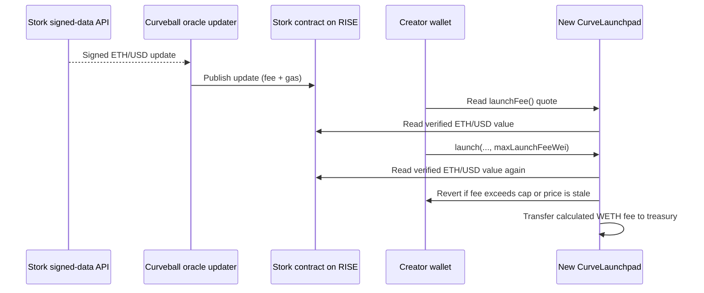

# Stork design for the $1 launch spam fee

Status: Stork selected on 2026-11-03. This is a design, not an active fee change.
The deployed testnet launchpad still charges an immutable `0.001 WETH`.
Stork ETH/USD on RISE testnet and mainnet is currently stale, and Curveball does
not yet have Stork signed-update API access. Do not deploy the new fee path until
both networks have been updated and tested with live signed data.

## Chosen flow

The updater is a separate process with a funded signer for each RISE network.
It keeps the `ETHUSD` feed fresh; it does not set the launch fee. Each launch
derives the fee from the latest Stork price *inside the same transaction that
collects WETH*. A price outage stops new launches. It never silently falls back
to an old or fixed fee.

Stork lists the same contract address on [RISE mainnet and testnet](https://docs.stork.network/resources/contract-addresses/evm):
`0xacC0a0cF13571d30B4b8637996F5D6D774d4fd62`. Its [asset registry](https://docs.stork.network/resources/asset-id-registry)
lists `ETHUSD` as
`0x59102b37de83bdda9f38ac8254e596f0d9ac61d2035c07936675e87342817160`.
The [EVM interface](https://docs.stork.network/api-reference/contract-apis/evm)
returns a nanosecond timestamp and an 18-decimal signed USD price. The safe
getter checks Stork's own validity period; the launchpad adds a stricter
application limit of five minutes and rejects a nonpositive or future price.
Use `getTemporalNumericValueV1`, never the unsafe getter.

Stork's [subscriber guide](https://docs.stork.network/getting-started/becoming-a-subscriber)
asks developers to contact Stork Labs; it does not document self-service token
issuance or public subscription pricing. Its [pushed-assets list](https://docs.stork.network/resources/stork-pushed-assets)
includes RISE testnet ETH/USD but does not list RISE mainnet pushes. The
mainnet contract and old feed value exist, but live mainnet ETH/USD publishing
must be confirmed with Stork before this design is treated as deployable.

## Onchain module interface

- Replace the immutable fee amount with a dynamic `launchFee()` view. It reads
  Stork and returns the current WETH wei required for $1; existing fee display
  can still call this function. It may revert if the feed is unavailable.
- Extend `launch` with `maxLaunchFeeWei`. The launchpad recalculates the fee
  and reverts before collecting WETH when it exceeds the creator's cap.
- If Stork returns ETH/USD price `P` with 18 decimals, calculate
  `ceil(10^36 / P)` WETH wei. Rounding up changes the dollar amount by less
  than the value of one wei. The launchpad charges the computed fee directly
  to the existing treasury.
- Check `P > 0`, feed timestamp, an application freshness limit, and the
  caller's fee cap. Allow at most 60 seconds of future clock skew between the
  signed timestamp and RISE block time. Preserve the current launch pause
  behavior. Invalid or stale data reverts; it does not waive the spam fee.

This gives callers one quote method and one extra launch argument. Oracle
decoding and validation stay inside the fee module, so the wallet and tests use
the same interface. The update signer and Stork API credential are not part of
the browser or launch transaction.

## Wallet, app, and updater

- The SDK reads `launchFee()` shortly before submission, wraps and approves
  enough WETH for `maxLaunchFeeWei + initialBuy`, then passes the cap to
  `launch`. A small displayed buffer, initially 2%, covers price movement
  between quote and inclusion. The actual charge is the onchain calculation;
  unused approved WETH stays in the creator's wallet.
- The launch page shows an estimated WETH fee, the $1 purpose, and the maximum
  WETH fee. It already blocks submission when it cannot read the fee; preserve
  that behavior. A cap breach prompts a fresh quote and retry.
- A separate oracle-updater process reads signed ETH/USD updates using a
  Stork credential held in runtime secrets, calls Stork's
  `getUpdateFeeV1` and `updateTemporalNumericValuesV1`, and pays the required
  fee and gas on each chain. The update fee is currently 1 wei, but must be
  queried rather than hardcoded. [Stork's update guide](https://docs.stork.network/getting-started/putting-data-on-chain)
  describes this publisher model. Monitor last update age, update failures,
  signer balance, and launch-read freshness. Keep the API credential out of
  Git, Docker images, logs, and the frontend.

## Release and migration

The old launchpad cannot be changed by an owner transaction because its fee
amount is immutable. The deployment script, recorder, source verification,
ABIs, smoke test, SDK, frontend, and updater configuration need changes. The
escrow, LP locker, and holder reserve all reference the launchpad address at
construction, so the new release must deploy all four singletons again.

Existing markets stay on the old contracts. The current frontend, social
indexer, and graduation keeper each use one launchpad address. Switching that
address in the current social indexer retires old market rows. Before routing
new users to the new release, either add multi-launchpad indexing and SDK
routing or run a separate legacy app/indexer/database/keeper stack for old
markets. Do not point two single-launchpad indexers at the same social database.

Rollout gates:

1. Obtain Stork signed-update access for `ETHUSD`. Confirm support for both
   RISE networks, test credentials, update method, rate limits, and commercial
   terms; then publish fresh signed updates on both networks. No credential is
   needed in chat.
2. Implement and test the onchain fee module and updater with stale, future,
   negative, rounding, cap, replay, and failed-update cases.
3. Update SDK/UI and prove the current and maximum fee displays match the
   contract calculation. Prepare a legacy-market migration path.
4. Deploy a new testnet release and run a launch smoke test with a fresh feed;
   verify the charged WETH equals the onchain $1 quote. Only then prepare
   mainnet deployment.

At present, step 1 is blocked by missing Stork subscriber access and stale
onchain feeds. The existing testnet release remains usable with its fixed fee.
